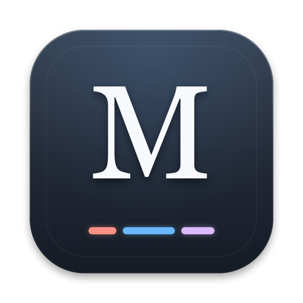

# MarkRead

**Typora의 타이포그래피 미학에서 영감을 받은 무료 · 완전 오프라인 macOS / Windows 미니멀 Markdown 리더.**

[English](README.md) | [简体中文](README.zh-CN.md) | [繁體中文](README.zh-TW.md) | [日本語](README.ja.md) | 한국어

MarkRead는 오직 쾌적한 로컬 Markdown 읽기에만 집중합니다. 계정 가입, 구독, 네트워크 요청 없이 모든 문서가 내 컴퓨터에서 즉시 렌더링되며, 세련된 타이포그래피, 오프라인 Highlight.js 문법 강조, 네이티브 데스크톱 통합을 제공합니다.

## 주요 기능

- **네이티브 & 초경량**: macOS는 순수 SwiftUI + WebKit(약 2.5 MB), Windows는 Tauri v2 + WebView2(설치 파일 약 2.2 MB)로 빠른 실행과 완전 오프라인 동작 지원
- **Finder Quick Look 지원 (macOS)**: `MarkReadQuickLook` 확장 내장 — Finder에서 `.md` 파일을 선택하고 스페이스바를 누르면 문법 강조가 적용된 미리보기를 즉시 확인
- **5가지 Typora 스타일 테마**: **GitHub(자동 라이트/다크)**, **GitHub Light**, **Night**, **Newsprint**, **Vue** — 창 제목 표시줄과 자연스럽게 통합
- **오프라인 Highlight.js 문법 강조**: 35개 이상 언어 오프라인 내장, 언어 배지 표시 및 원클릭 코드 복사 지원
- **풍부한 Markdown 렌더링**: GFM 표, 커스텀 체크박스 작업 목록, 취소선, GitHub/Obsidian Callout 카드(`NOTE` / `TIP` / `IMPORTANT` / `WARNING` / `CAUTION`), `==형광펜 강조==`, YAML Front Matter 토글, 상대 경로 로컬 이미지(클릭 시 라이트박스 확대) 및 상대 `.md` 링크 이동
- **읽기 생산성**: 스크롤과 동기화되는 접이식 목차(TOC) 사이드바, 단어 수 및 예상 읽기 시간 표시, 문서 내 검색 및 이동, 외부 편집기 저장 시 스크롤 위치를 유지하는 자동 새로고침
- **내보내기**: 깔끔한 **PDF** 및 단일 파일 **HTML** 내보내기 지원
- **5개 언어 지원**: 한국어, English, 简体中文, 繁體中文, 日本語 — 시스템 언어 자동 적용 및 재시작 없는 실시간 언어 전환

## 설치 방법

### macOS (Homebrew 권장)

Apple Developer ID 서명 및 Apple 공증(Notarization)을 완료하여 설치 후 바로 실행할 수 있습니다:

```bash
brew tap tluo-github/markread https://github.com/tluo-github/markread
brew install --cask markread
```

업데이트: `brew upgrade --cask markread` · 제거: `brew uninstall --cask markread`

### 직접 다운로드 (macOS & Windows)

[GitHub Releases](https://github.com/tluo-github/markread/releases/latest)에서 다운로드하세요:

- **macOS (Apple Silicon)**: `MarkRead-<version>-arm64.dmg`
- **macOS (Intel)**: `MarkRead-<version>-x86_64.dmg`
- **Windows 설치 버전** (`.md` 파일 연결 자동 등록, 관리자 권한 불필요): `MarkRead_<version>_x64-setup.exe` 또는 `.msi`
- **Windows 포터블 버전** (설치 없이 바로 실행): `MarkRead-portable-x64.exe`

## 단축키

| 기능 | macOS | Windows |
| :--- | :--- | :--- |
| Markdown 파일 열기 | `⌘O` | `Ctrl+O` |
| 목차(TOC) 토글 | `⇧⌘O` | `Ctrl+Shift+O` |
| 문서 내 찾기 / 다음 / 이전 | `⌘F` / `⌘G` / `⇧⌘G` | `Ctrl+F` / `F3` / `Shift+F3` |
| Front Matter 표시/숨기기 | `⇧⌘M` | `Ctrl+Shift+M` |
| 확대 / 축소 / 원래 크기 | `⌘+` / `⌘-` / `⌘0` | `Ctrl++` / `Ctrl+-` / `Ctrl+0` |
| 파일 다시 불러오기 | `⌘R` | `Ctrl+R` |
| Finder / 탐색기에서 보기 | `⇧⌘R` | `Ctrl+Shift+R` |
| HTML 내보내기 | `⇧⌘E` | `Ctrl+Shift+E` |
| PDF 내보내기 / 인쇄 | `⇧⌘P` | `Ctrl+P` |

## 프로젝트 구조

- `shared/web/`: macOS와 Windows가 100% 공유하는 오프라인 렌더링 엔진 (`markdown-it`, `Highlight.js`, `themes.css`, `renderer.js`)
- `MarkRead/` & `MarkReadQuickLook/`: 네이티브 macOS SwiftUI 앱 및 Finder Quick Look 확장
- `windows/`: Tauri v2(Rust + WebView2) 기반 경량 Windows 앱
- `.github/workflows/build-windows.yml`: GitHub Actions 기반 Windows NSIS / MSI / 포터블 EXE 자동 빌드

## 소스에서 빌드

### macOS

Xcode와 [XcodeGen](https://github.com/yonaskolb/XcodeGen)이 필요합니다:

```bash
./scripts/build.sh --run     # 로컬 빌드 및 실행
./scripts/install.sh         # /Applications 설치, Quick Look 활성화 및 .md 기본 앱 설정
./scripts/release-macos.sh   # arm64 + x86_64 서명, 공증 및 DMG/ZIP 패키징
```

### Windows

Rust stable, Node.js, `@tauri-apps/cli@2`가 필요합니다:

```bash
./scripts/sync-windows-web.sh
cd windows && tauri build
```
